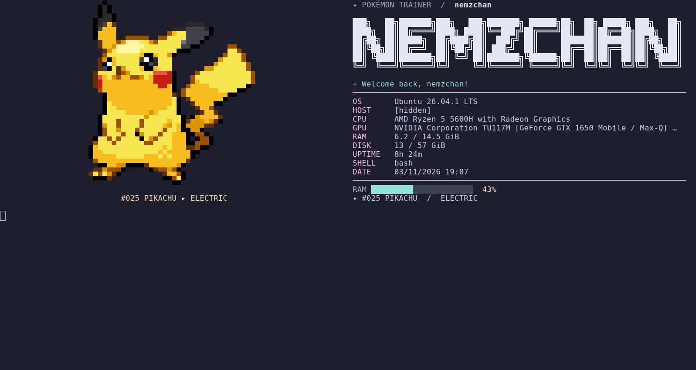
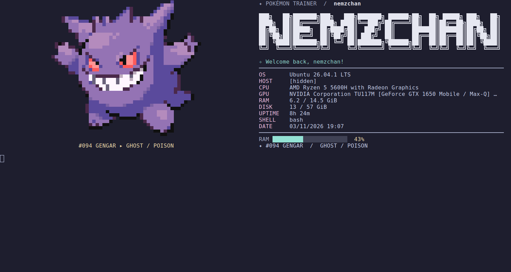
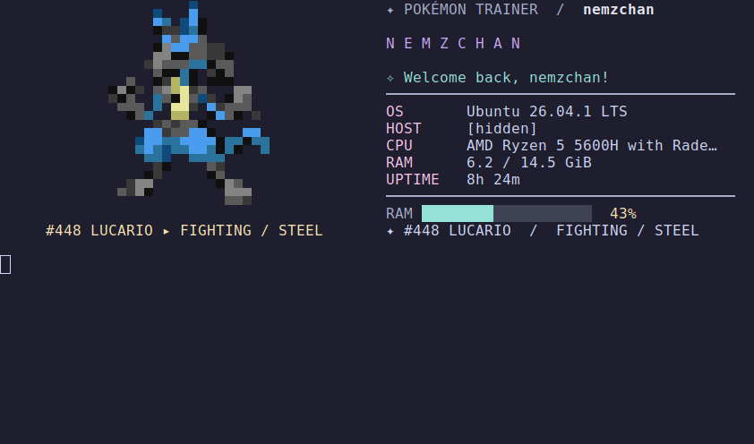

# Pokémon Welcome

An offline Pokémon greeting for your Linux terminal, featuring random pixel art,
a custom banner, and system information. Includes 20 Pokémon.

## Installation

Requires Linux, Python 3.9+, and Bash or Zsh.

Install the dependencies on Ubuntu/Debian:

```bash
sudo apt update
sudo apt install git python3 python3-pil
```

```bash
git clone https://github.com/Nemztran/Pokemon-Terminal.git
cd pokemon-welcome
bash install.sh
```

Open a new terminal to see the greeting. You can also run it manually:

```bash
~/.local/bin/pokemon-welcome
```

The installer detects your shell and backs up its configuration before adding
the startup greeting. No `sudo` is needed for `bash install.sh`.

If the installer selects the wrong shell, choose it explicitly:

```bash
bash install.sh --shell bash
# For Zsh: bash install.sh --shell zsh
```

## Demo

Real terminal screenshots from the author's machine, with the hostname hidden.

### Pikachu — wide layout



### Gengar — wide layout



### Lucario — compact layout



## Change your banner

Replace `YOURNAME` with the name you want in the large banner:

```bash
~/.local/bin/pokemon-welcome banner "YOURNAME"
```

This generates an **ANSI Shadow** banner using TAAG and saves it automatically.
Internet access is needed only to generate it. Run the greeting again to see it:

```bash
~/.local/bin/pokemon-welcome
```

Your custom banner is kept when you update or reinstall the application. If the
terminal is too narrow for the full artwork, your name appears as compact text.

### Use the TAAG website instead

You can also choose and copy the banner yourself:

1. Open [TAAG — ANSI Shadow](https://taag.fun/#f=ANSI+Shadow&t=NEMZCHAN).
2. Replace **NEMZCHAN** with your name. Keep **ANSI Shadow** selected for the
   same style as the demo.
3. Copy the result into a plain text file, such as `~/banner.txt`. Keep the
   spaces and line breaks; do not add Markdown code fences.
4. Import that file, replacing `YOURNAME` with your name:

```bash
~/.local/bin/pokemon-welcome banner --from-file ~/banner.txt --label "YOURNAME"
```

Importing from a file also works when automatic generation is unavailable.

To restore the original banner:

```bash
~/.local/bin/pokemon-welcome banner --reset
```

## Change the greeting name

The name in **Welcome back, ...!** is separate from the large banner and defaults
to your system username. To change it, add this line to `~/.bashrc` for Bash or
`~/.zshrc` for Zsh, **before** the `# >>> pokemon-welcome >>>` block:

```bash
export POKEMON_TRAINER="YourName"
```

Open a new terminal to apply the change.

## Directory and Git prompt

Enable an optional [Starship](https://starship.rs/) prompt with connected pastel
segments: **username → current directory → Git branch/status → HH:MM**. The left
edge is rounded and the right edge ends in an arrow. Branch names update as you
switch branches; the working directory updates as you navigate.
Git status shows `?N` for untracked files, `~N` for modified files, and `+N` for
staged files.

Install Starship using its [official instructions](https://starship.rs/guide/#installation),
then reinstall this project to get the new command:

```bash
bash install.sh
~/.local/bin/pokemon-welcome prompt --install --shell bash
# For Zsh: ~/.local/bin/pokemon-welcome prompt --install --shell zsh
```

Open a new terminal to activate it. This feature is opt-in: installing the greeting
alone keeps your existing prompt. It does not change the banner, Pokémon, or
terminal font. The theme is based on Starship's
[Pastel Powerline preset](https://starship.rs/presets/pastel-powerline.html).

Powerline separators and the Git icon require a compatible font, such as one
from [Nerd Fonts](https://www.nerdfonts.com/). If icons appear as rectangles, choose
a compatible font in the terminal that displays the prompt. VS Code's integrated
terminal has its own `terminal.integrated.fontFamily` setting. Changing a terminal
font also affects how the greeting looks; this installer leaves that choice to you.

The command backs up the shell startup file, uses a separate theme at
`${XDG_CONFIG_HOME:-~/.config}/pokemon-welcome/starship.toml`, and preserves an
existing Starship initialization. Your global `starship.toml` is untouched.
Reinstalling preserves edits to the separate theme.

To inspect the bundled theme or remove the prompt while keeping the greeting:

```bash
~/.local/bin/pokemon-welcome prompt --print-config
~/.local/bin/pokemon-welcome prompt --uninstall
```

Open a new terminal after uninstalling to restore your previous prompt.

## Uninstall

From the project folder:

```bash
python3 install.py --uninstall
```

## License

Code: [MIT](LICENSE). Pokémon artwork belongs to its respective owners.
See [NOTICE.md](NOTICE.md).
